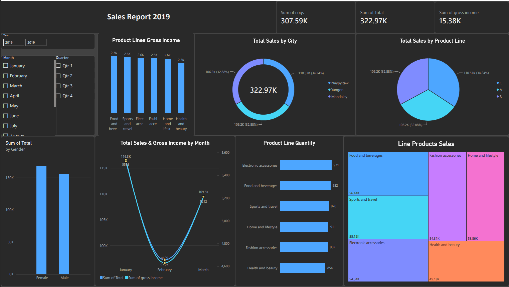

## SuperMarket Sales Dashboard

- Built an interactive Power BI report on Q1 2019 supermarket sales with 3 KPI cards (Total Sales, COGS, Gross Income),
Year / Month / Quarter slicers, and 7 visuals (donut, pie, column, bar, line, and treemap charts).
- Analyzed sales by city, product line, gender, and month to show where revenue and profit come from.
- Key insights:
  1. $322.97K in sales and $15.38K gross income (about 4.8% margin)
  2. Naypyitaw leads cities with 34.2% of sales
  3. Food and beverages leads in sales ($56.1K) while Electronic accessories lead in units (971)
  4. Female customers contribute more sales than male
  5. January peaked at $116.3K and February dipped to $97.2K.
---

